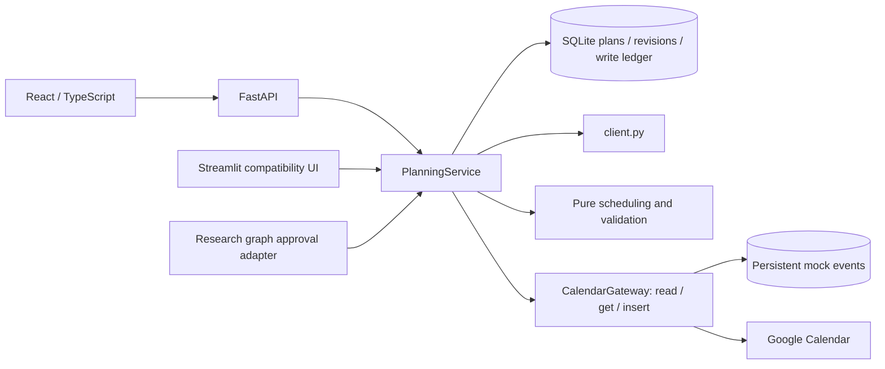

# Architecture

The main product is a local, single-user planning workspace. Current verification and remaining work live in [STATUS.md](STATUS.md); the earlier research design is preserved in `docs/archive/` and the project report.

## Boundaries



`src/domain/models.py` contains validated Pydantic request/storage contracts. Algorithms consume ordinary dictionaries and have no I/O. `src/planning/service.py` owns workflow state changes. `src/planning/store.py` owns persistence and per-plan locks. Frontends never submit an arbitrary event list as an approved schedule.

## State and revisions

```text
create → draft → decompose → editable tasks → generate → review
review → update draft → generate → review
review → reject → rejected
review → approve → preflight → needs_review OR writing
writing → completed OR partial
partial/writing → retry → reconcile → preflight → continue
```

The plan stores its goal, preferences, calendar identity/mode, stable task IDs and DAG, candidates, calendar snapshot, immutable approval identity, and write results. Decomposing, editing, and generating increment the revision. Editing invalidates candidates. A browser can reload a saved stage by `?plan=<id>`; work in progress is synchronous and does not resume automatically after a process dies.

SQLite uses WAL, unique plan/revision and plan/event keys, and POSIX `flock` locks around each plan mutation. Locks are released when a process exits. This coordinates API and Streamlit processes using the same local database. It is not a distributed lock or a lock on an entire external calendar.

## Time and task contracts

- API preferences contain an IANA timezone and a date-only deadline. Its exclusive boundary is midnight at the start of the following local day.
- Event timestamps are offset-aware ISO 8601 values. Naive event timestamps are rejected; elapsed duration and interval arithmetic use absolute instants. Local working days, hours, and energy periods use the plan timezone.
- Tasks have stable IDs, explicit `depends_on`, complexity, and positive duration. Legacy structural tags are translated once at the boundary. Missing prerequisites, duplicate IDs, and cycles fail validation.
- Each task currently occupies one session. Tasks longer than the configured session limit or with unscheduled prerequisites remain unscheduled; they are not silently split or repaired.
- A shared pure engine implements earliest-slot, larger-slot, and energy-aware policies. It considers energy-period boundaries as possible starts. These are greedy heuristics, with no optimality guarantee.
- Validation covers task coverage/identity/dependencies, duration, session length, workdays/hours, breaks, deadline, invalid intervals, existing-event overlap, and self-overlap. Preflight also surfaces uncreated events that are already in the past.

Calendar reads interpret all-day events in the calendar timezone, ignore transparent/cancelled/self-declined events, and fail on invalid intervals or read errors. Read errors never mean “calendar is free.”

## Approval and add-only writes

1. The request supplies the displayed revision, candidate ID, schedule snapshot hash, and explicit acknowledged violation IDs. Stale or mismatched requests fail.
2. The service checks the saved calendar mode and ID against the running configuration. Opening a live plan while running in mock mode cannot invoke live writes.
3. Unknown prior writes are looked up by deterministic provider event ID. Only a response matching the approved title and times is confirmed. Lookup errors stop the operation.
4. A fresh busy-calendar read excludes confirmed events from this approval. Newly discovered violations produce `needs_review`; the schedule is not automatically changed. Each new issue needs explicit acknowledgement.
5. The approval is saved before the first insert. Approved tasks and schedules are then locked against edits or switching candidates.
6. Each event is recorded as `unknown` before any external operation. A matching successful response becomes `confirmed`. An error preserves the unknown state and stops the batch, keeping successful events.
7. Retry reconciles unknown results first, skips confirmed events, and attempts only missing ones with the same provider IDs. Repeated approval of a completed snapshot returns the saved result.

Google IDs are derived from plan/revision/snapshot/event identity using a lowercase hexadecimal SHA-256 digest. There are no update/delete operations and no rollback deletion. This improves idempotency; it does not provide an atomic transaction across SQLite and Google, nor prevent unrelated calendar edits between preflight and insert.

## LLM and research modes

The product makes one logical decomposition call through `src/llm_client/client.py` (provider retries remain possible). The response is parsed and validated into the task schema and DAG. Metrics and short explanations are deterministic. Provider-native structured-output schemas are not yet implemented.

The optional `build_graph()` path retains decomposition critique, candidate reviewers, and rationales for research comparisons. It ends after `build_proposal`; there is no claimed LangGraph checkpoint/interrupt. `run_graph_until_approval()` returns that proposal with a stable plan ID. `resume_graph()` is a compatibility helper that records a decision and routes an approved proposal through the shared ledger. It is not durable graph resumption. The research graph's `debug_trace` remains available programmatically.

## API and UI

`src/api/app.py` provides config, list/create/get plans, decomposition, draft update, candidate generation, approval, and rejection. Mutations validate requests and return 409 for revision/approval conflicts. Built React assets are served from `web/dist`; Vite proxies API calls during development.

The React workflow has goal, task, comparison, and confirmation steps. Radix handles the approval dialog. A lazy-loaded FullCalendar React week view uses the Luxon named-timezone plugin; the agenda is the mobile/default view. The React state controls the calendar view, with no iframe or competing stored view. Streamlit consumes the same service with simpler editing and tables.

The API restricts Host/Origin for local use, but has no authentication, user ownership isolation, or web OAuth callback. Those are prerequisites for a public service. SQLite and its stored plan/calendar data must stay on the user's local machine in this release.
