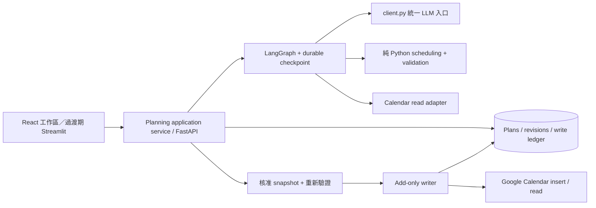
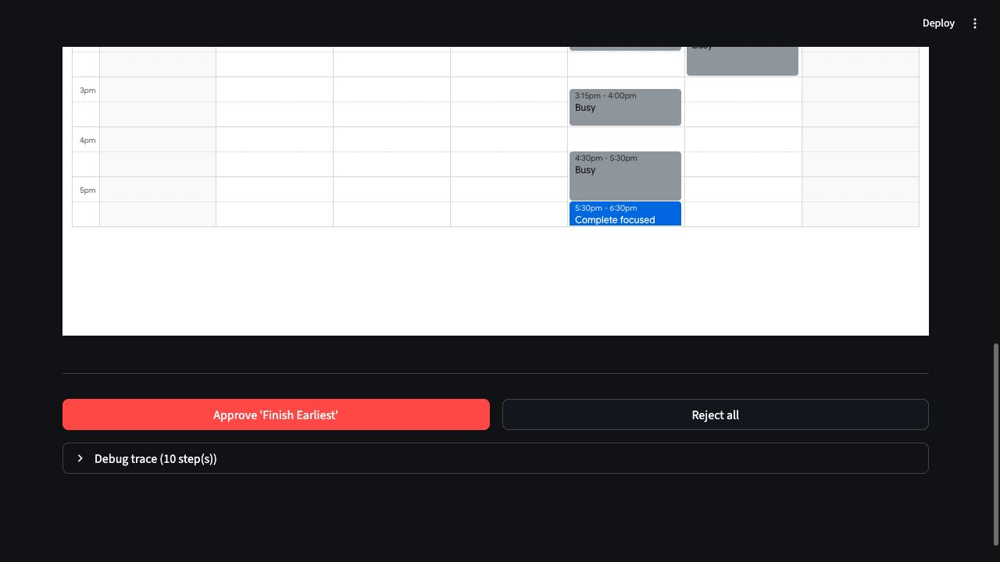
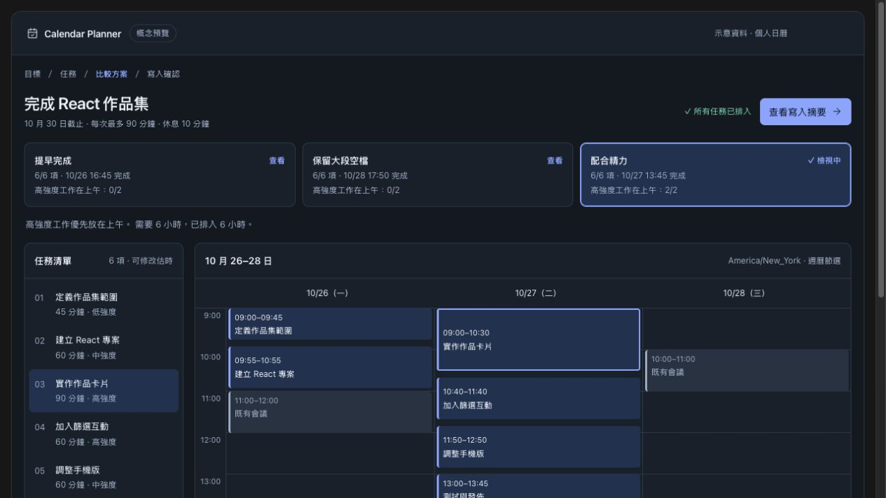

# Calendar Planning Agent：重構與 UI/UX 檢視

檢視日期：2026-10-22。基準 commit：`80c1068`。本文保留重構前的問題與設計建議，行號指向當時版本。後續已實作本機規劃工作區，實際交付範圍、測試與剩餘限制請見 [STATUS.md](STATUS.md)。

建議方向：保留 Python 排程與驗證核心，以「可以修改、比較、保存並可靠寫入的規劃工作區」為產品目標。先修正時間與完整性，再建立資料契約、持久化與 API，最後逐步替換 Streamlit 使用者介面。

**檢視範圍與證據。** 已讀取應用流程、前端、LangGraph、三種 heuristic、validator、LLM client、Google Calendar adapter、設定、測試與 CI、部署腳手架及現況文件。已在本機以 `CALENDAR_MODE=mock LLM_PROVIDER=mock` 操作 UI，另用獨立 Python 探針重現邊界問題。沒有呼叫真實 LLM，也沒有寫入真實 Google Calendar；mock 結果不能用來推論真實模型品質、成本或延遲。

離線驗證：`CALENDAR_MODE=mock LLM_PROVIDER=mock .venv/bin/pytest tests/ -q --ignore=tests/llm_integration` → **187 passed, 31 skipped**。其中 programmatic suite 為 118 passed。31 個跳過測試依賴真實 LLM fixture。沒有把 skip 算成通過，也未重新驗證文件中的歷史 live 成績。

**值得保留的基礎。** 三種策略與 validator 已和 API/LLM 分離；所有 LLM 呼叫已有共同入口；mock 模式可用；rationale 失敗有本地 fallback；使用者選方案後才進入 add-only writer。這些是可延續的基礎，重構應保留介面與行為測試。

**優先問題與具體重現。** P0 表示下一輪重構前應先修復的正確性／寫入問題；P1 為產品化必要工作；P2 為後續改善。以下嚴重度是本次評估，並非已發生線上事故。

| 優先 | 發現與來源 | 重現／影響 | 重構方向 |
|---|---|---|---|
| P0 | 截止日期語意不一致。`src/orchestration/nodes/validate_candidates.py:74` 與 `fetch_events.py:72` | `2026-10-23` 被 validator 解析成當日 `00:00 UTC`，但 fetch 採使用者時區當日結束。當天紐約 09:00–10:00 的事件因此被標為 `DEADLINE_EXCEEDED`。 | 建立唯一 `PlanningWindow`；date-only 明確定義為指定時區當日結束，建議用次日零時的 exclusive boundary；所有模組共用。 |
| P0 | 帶不同 UTC offset 的時間未先轉成工作時區。`src/calendar_api/free_slots.py:120`、`src/validator/constraints.py:98`、`src/frontend/task_breakdown.py:23` | busy block 結束於 `17:30 UTC` 時，後續候選可保留 UTC offset。實際紐約 13:30–14:30 的工作，被 `.time()` 判成 17:30–18:30 而誤報超出工時；表格同樣顯示原 offset 的時鐘時間。 | 儲存 absolute instant，另存 IANA timezone；工作日、精力、截止日及顯示全部在明確時區計算。涵蓋 DST、全天事件、跨日與混合 offset。 |
| P0 | 排不下的任務消失，驗證未涵蓋完整性與前置任務。`src/orchestration/heuristics/deadline_first.py:92`、`src/validator/constraints.py:24` | 只有 60 分鐘空檔，先修任務需 90 分鐘、後續任務需 30 分鐘，結果只排後續任務且 `passed=True`；空 schedule 也得到 `passed=True`。表格雖會顯示 Not scheduled，但總體「No conflicts」無法表達可否完成目標。 | 回傳 `scheduled` 與 `unscheduled[{task_id, reason}]`，驗證 task coverage、依賴、duration、session 上限、break 與時間有效性。把「時間無衝突」與「目標完整」分成不同狀態。 |
| P0 | 重複核准與部分寫入缺少可恢復的契約。`src/calendar_api/events.py:199`、`src/orchestration/graph.py:357`、`src/app.py:170` | 對同一 paused state 核准兩次，mock writer 呼叫兩次。模擬第二筆 insert 失敗時，第一筆已建立，但 batch 直接拋錯，無回傳已完成清單；UI 的核准分支亦沒有對應錯誤處理。 | 不可變 approved snapshot、request idempotency key、每筆 event 寫入紀錄、穩定 Google event ID、pending/confirmed/failed/unknown 狀態；重試先查證未知結果，再只建立缺少項目。保持 add-only，不能靠刪除做 rollback。 |
| P1 | 審核後的日曆可能已變動。`src/orchestration/nodes/write_events.py:37` | writer 直接使用舊 `final_schedule`，未讀取新 busy 狀態。使用者停留 review 期間新增的行程不會反映在原驗證。 | 寫入前重新讀取並驗證；新增衝突轉成 `needs_review`，把差異交給使用者。重查仍無法形成跨 Google Calendar 的原子交易，須保留寫入結果與後續對帳能力。 |
| P1 | 任務關係藏在自然語言，沒有穩定 ID。`src/orchestration/state.py:20`、`heuristics/_structural.py:46`、`frontend/task_breakdown.py:33` | 用 regex 讀 `[group] [seq] [shuffle] [complexity]`，UI 以 task name 配對 event；改名、同名、拆成多段、編輯依賴都容易失去對應。`seq` 主要鎖定既有順序，並非真正的依賴圖。 | 明確 task schema、stable ID、`depends_on` DAG；時間片段用 `task_id + segment_id` 關聯。文字描述只保存給使用者閱讀的內容。 |
| P1 | LangGraph 與手動 resume 維護兩套流程。`src/orchestration/graph.py:234`、`:357` | compile 沒有 checkpointer；`resume_graph()` 忽略 graph 參數，手動呼叫 approval/write nodes。狀態主要存在 Streamlit session，沒有 plan history 或重啟續接的持久化路徑。 | 若保留 LangGraph，採 durable checkpointer、`thread_id`、`interrupt()`、`Command(resume=...)`；approved snapshot 與寫入紀錄仍獨立保存。若不要 durable graph，則明確簡化成 application service，避免名義上 resume graph、實際繞過它。 |
| P1 | LLM 評審成本與可解釋性不成比例。`nodes/review_candidates.py:18`、`:169`、`nodes/generate_rationales.py:168` | 實際為 1 拆解 + 1 critic + 4 reviewer + 3 rationale，正常 9 次、加一次 revision 為 10 次邏輯呼叫，尚未計 provider retry。review/rationale 各自在 loop 中依序呼叫。fallback 固定給 8/6 分，UI 沒有明顯區分分數來源。 | 先由程式計算完成時間、coverage、每日負荷、精力配合、空檔等指標，合併成一次簡短解釋；critic 作為可評估的選項。研究模式可保留多 reviewer，但產品模式須以測試證明額外呼叫的價值。 |
| P1 | UI 控制狀態重複，主要動作距離內容太遠。`frontend/schedule_display.py:105`、`calendar_html.py:268`、`:372` | 實測外層 Week 已選中，iframe 仍是 Month：localStorage 覆蓋 `INITIAL_VIEW`。外層深色、日曆固定白色；任務表＋760/820px iframe 後才有核准按鈕，閱讀與操作分離。 | 使用單一受控的 calendar component；同步 view/date/selection；統一 theme；週曆與比較指標在主要區域，任務細節在側欄，核准摘要在頁面固定可見區域。 |
| P2 | 精力策略只看候選空檔起點。`heuristics/energy_aware.py:137` | 09:00–18:00 整段空閒、早上 low／下午 high，60 分鐘高強度任務仍排 09:00，沒有把中午當作可選起點。 | 先依精力區段切開 slots／列舉合法起點；分清硬限制與軟偏好；再用 benchmarks 評估改進。 |
| P2 | 工程與文件契約漂移 | `STATUS.md` 把全部 pipeline tests 寫成無憑證；`ARCHITECTURE.md` 的 approval mutation 已過時；兩份 dependency ranges 現在一致，舊 caveat 不應再當問題；沒有追蹤 lockfile。部署腳本實際動作均是 TODO，CloudFormation 缺 Service/ALB。 | 以 pyproject 作單一依賴來源、提交 lockfile；拆開 offline tests/live eval，增加真實 UI 流程測試；更新現況文件；先做可重現的單服務部署，再依需求擴充。 |

目前的日曆展示載入 FullCalendar 6.1.11 CDN，設定 IANA timezone 但未載入 named-timezone implementation。這是與後端時間處理分開的顯示風險：v6 無插件會採 UTC-coercion。遷移前應針對實際版本測試 DST 與含 offset 的事件，不能只換個時區字串就視為修復。[FullCalendar v6 時區規則](https://legacy.fullcalendar.io/v6/timeZone)

Google Calendar 讀取 adapter 也把全天事件起訖強制設為 UTC，且未依 `transparency`／使用者拒絕狀態等語意作完整處理。若產品只需 busy blocks，可考慮官方 FreeBusy API；若要展示事件標題與細節，再保留 events list 路徑。每個行事曆讀取錯誤都應明確顯示，不能當成沒有忙碌事件。[FreeBusy 文件](https://developers.google.com/workspace/calendar/api/v3/reference/freebusy/query)

**建議的技術組合與取捨。** 以下以持續使用的個人生產力 Web app 為假設。若目標仍是課堂展示或 Python 團隊內部工具，可以採表中的 Streamlit 過渡方案，減少第二個語言與部署流程的成本。

| 範圍 | 建議 | 帶來的能力與成本 |
|---|---|---|
| 使用者前端 | React + TypeScript + Vite | 可控的複雜互動、清楚的前後端契約；需維護 JS toolchain。此產品重點是登入後工作區，先採單頁應用已足夠；有獨立的 SEO／SSR 需求才再評估 Next.js。[Vite](https://vite.dev/guide/) |
| UI 元件 | shadcn/ui，建立專案自己的 design tokens | 統一表單、dialog、drawer、鍵盤操作與主題；仍需設計資訊層級，不能把安裝元件庫當成完成 UX。[shadcn/ui](https://ui.shadcn.com/docs) |
| 日曆 | FullCalendar React，明確鎖定並測試版本 | 延續目前日曆投資；直接同步事件選取、view/date、draft drag/resize。拖曳只改草稿並重新驗證，不更新 Google 既有事件。[FullCalendar React](https://fullcalendar.io/docs/react) |
| API | FastAPI + Pydantic | 讓 Streamlit 與新前端暫時共用 application service；schema 作執行期驗證並生成 API 契約。用 SSE 回報可理解的階段，先完成 REST／狀態查詢再加 streaming。[Pydantic](https://docs.pydantic.dev/latest/concepts/models/)、[SSE](https://fastapi.tiangolo.com/tutorial/server-sent-events/) |
| 持久化 | SQLite 用於本地單機；多人部署時使用 PostgreSQL | 保存 plans、revisions、approved snapshots、event writes。SQL transaction 保護本地狀態，不能涵蓋外部 Calendar API；需要每筆結果紀錄與 reconciliation。 |
| 工作執行 | 單一 application service 起步；需要斷線／程序重啟續跑時再加持久化 job runner | SSE 是進度傳遞，不是可靠背景執行。FastAPI BackgroundTasks 也不能替代 durable job storage。先定義 job 狀態，再依實際負載選 worker/queue。[BackgroundTasks 限制](https://fastapi.tiangolo.com/tutorial/background-tasks/) |
| 工作流程 | 保留 LangGraph，真正接上 persistence/interrupt | 用現有投資支援人工修改／核准節點，避免一次重寫。若功能簡化為固定短 pipeline，之後可換成較單純的 service。[LangGraph interrupts](https://docs.langchain.com/oss/python/langgraph/interrupts) |
| LLM 邊界 | Pydantic schema + provider 原生 structured output，保留 `client.py` facade | 減少 regex 修 JSON 的需求；原生 schema 支援須按 provider/model 驗證，結構正確仍不保證依賴或時間估算正確。不支援的 provider 仍需 schema validation 與明確失敗處理。[Gemini structured outputs](https://ai.google.dev/gemini-api/docs/structured-output) |
| 排程 | 第一階段保留純 Python，補 DAG、coverage、slot segmentation | 先修正輸入與約束再比較演算法，避免新 solver 掩蓋資料問題。 |

OR-Tools CP-SAT 值得列為後續研究選項：用 interval variables、precedence、no-overlap 與不同 objective weights 產生三種風格，改善貪婪法的局部選擇。但它是原生 solver 的 Python binding；若 AGENTS 的「pure Python」為字面限制，便不符合目前規範。因此不把它列為本次建議的直接依賴。即使未來採用，也要設定時間上限、報告 feasible/optimal/infeasible/unknown，並保留獨立 validator，不能承諾一定找到最優解。[OR-Tools scheduling](https://developers.google.com/optimization/scheduling/job_shop)

**資料契約應先於前端搬家。** 建議新增的概念為：

```text
Task: id, title, description, duration_minutes, complexity,
      depends_on[], splittable, minimum_segment_minutes
PlanningPreferences: timezone, deadline_date, workdays,
      working_windows, daily_budget_minutes, max_session_minutes,
      break_minutes, energy_profile
Candidate: id, strategy, events[], unscheduled[], metrics,
      validation, explanation_source, input_revision
ProposedEvent: id, task_id, segment_id, start, end
PlanRevision: plan_id, revision, input_snapshot, calendar_snapshot_at,
      status, candidates
Approval: plan_id, revision, candidate_id, snapshot_hash,
      acknowledged_violation_ids[], idempotency_key
EventWrite: approval_id, event_id, provider_event_id, status, last_error
```

API／LLM 邊界使用 Pydantic，domain 內維持無 I/O 的計算。當使用者更改任務／時段，增加 revision，舊 candidate 的核准失效。用同一個 revision 和 snapshot hash 確保「看到的」就是「被核准的」。

建議第一批 API 為建立 plan、讀取 plan、更新 draft、產生 candidates、讀取進度、核准固定 revision、查詢 write results。後端每次皆驗證 plan ownership 與 revision；禁止直接讓前端提交任意 event list 當成已核准成果。



Google 官方允許建立時指定 event ID，用以避免成功後網路回覆遺失造成的重複建立。可用 approval/event identity 派生符合格式的穩定 ID，配合 DB unique constraint、寫入租約與讀取核對。這是改善冪等性的設計，不宣稱跨資料庫與 Google 的 exactly-once transaction。[官方事件 ID 說明](https://developers.google.com/workspace/calendar/api/guides/create-events)、[格式與限制](https://developers.google.com/workspace/calendar/api/v3/reference/events/insert)

目前 OAuth 使用固定 `token.json` 和 `InstalledAppFlow.run_local_server()`，適用本機單使用者。部署成多人服務前，才需要 web OAuth callback、依 user/calendar 隔離 token 與 plan、保護 refresh token。程式中的 scopes 註解不應暗示 OAuth scope 本身禁止 update/delete：add-only 是 application adapter 必須持續強制的契約。

**重新設計使用流程。**

1. **描述目標。** 第一屏只突出目標與截止日，提供「做一個作品集」等可編輯例子；日曆帳號、mock/live 與時區清楚可見。工作日、每日預算、break、精力放在可展開的偏好區。給使用者修改預設值與保存偏好的方式。
2. **確認任務。** 拆解後先讓使用者修改名稱、時數、依賴與可拆分性。以階段分組，提供「必要／可選」範圍選擇。顯示估計工時與實際可用容量；容量足夠僅是必要條件，不代表一定能排入。
3. **等待有回饋。** 使用「整理任務 → 讀取可用時間 → 建立方案 → 檢查限制」階段狀態，提供取消／重試且保留輸入。不使用無依據的百分比或秒數。排程先可見，額外說明可稍後補入。
4. **比較並調整。** 桌面以任務側欄＋週曆為中心；頂部同時看到三個方案的 coverage、預計完成時間、工作天數及實際精力配合指標。名稱使用「提早完成／保留大段空檔／配合精力」。選方案只切換同一個日曆，對比時高亮移動的事件。任務與事件以 ID 聯動。
5. **看懂限制。** 「無時間衝突」「6/8 任務已排入」「2 項待處理」分別顯示；點擊問題定位相關任務與事件，給手動調整範圍／截止日／工作時數的入口。相同候選合併並說明原因，不呈現假的三選一。評審／除錯資訊收至次要區域。
6. **確認新增。** 顯示「新增 6 個事件」、目標日曆、時區、總時數與事件清單。新發現的衝突或未排任務明確列出。依目前專案規則，由使用者判斷候選違規；若允許帶違規核准，需明確承認特定問題並記錄，不能悄悄當作全數通過，也不能由 AI 自動修補。
7. **完成或續傳。** 顯示每筆成功／失敗／待確認狀態、Google Calendar 連結、已保存計畫。部分失敗保留成功項目，只提供核對後補建未完成項目。保留草稿版本與退回編輯；已寫入項目的修改／刪除不在現行 add-only 範圍內。

**視覺與互動規格。** 採中性背景、一個主強調色、一致的字體與 8px spacing；灰色既有行程、草稿事件帶「草稿」文字，錯誤以圖示和文字辨識，不只用顏色。亮暗主題涵蓋日曆與 dialog。週視圖是比較預設，手機使用 agenda＋可展開任務，不把七欄日曆硬縮小。用鍵盤可開啟任務、調整時間並確認；拖曳須有表單替代操作。小螢幕維持可點擊區域與可讀文字。

主畫面避免長段模型 rationale 先佔滿畫面；把「為何這樣安排」收斂為可查證的一句 trade-off，例如「高強度任務都在上午，完成時間比提早完成方案晚一天」。任何量化指標都由 schedule 計算，不由 LLM 自行打分。若説明來自 fallback，直接標示「規則摘要」。

可比較兩種資訊架構：**規劃工作區**（任務側欄＋週曆，適合反覆調整）與 **引導式比較**（按步驟先比較方案，再看日期清單，適合初次使用與較小螢幕）。本次互動草圖使用示意資料，只展示選方案、編輯估時與核准摘要，不代表已接上現有 backend。

**建議交付順序與驗收。** 工期以熟悉此程式的一位工程師為粗估，不含正式 live OAuth 驗證、跨裝置完整測試與上線營運；各階段可獨立交付，實際時間取決於產品範圍。

| 階段 | 工作 | 驗收 | 粗估 |
|---|---|---|---|
| A | 時間語意、task coverage、依賴漏排、writer 冪等／部分失敗契約；修正文件 | 截止當日事件通過；混合 offset 與 DST 正確；先修漏排能定位；同一 approval 重試不重建已確認項目 | 3–5 工作日 |
| B | typed schema、plan/revision storage、application service、持久化 approval | 不經 Streamlit 可完成 mock 流程；重新整理／重啟可讀取草稿；修改後舊核准失效 | 4–7 工作日 |
| C | React review 工作區、任務編輯、三方案量化比較、單一日曆狀態、寫入摘要 | mock E2E 覆蓋生成／編輯／拒絕／核准／部分失敗；鍵盤可操作；手機 agenda 可用 | 5–8 工作日 |
| D | LLM 呼叫縮減、產品與研究模式比較、排程 benchmark | 固定案例上評估 completion/violation/cost/p50/p95 latency；保留品質較好的方案 | 2–4 工作日 |

若只需快速改善 demo，可先以 1–3 工作日調整 Streamlit：移除雙重日曆 view control、預設週視圖、摘要前置、清楚區分 mock/live 與未排任務、將偏好折疊、加入退回編輯與寫入結果。這條路仍必須處理 P0，且不能只靠 CSS 解決 session persistence 與 writer 契約。

**測試與評估策略。** 保留現有 pure function tests，新增真正跨模組的離線 workflow case；將真實 LLM eval 明確移出快速套件或標記。時間／排程優先測同名任務、缺失依賴、空候選、部分 coverage、不同 offset 的同一 instant、DST、全天事件與 deadline 邊界。writer 測「insert 成功但回覆遺失」「第二筆失敗」「重複核准」「review 後日曆改動」。UI 測輸入保存、view 同步、draft edit 使核准失效、拒絕零寫入與部分失敗恢復。可引入 property-based tests 產生時間區間組合，前端遷移時再加入瀏覽器 E2E；不以截圖字串或 mock 呼叫數取代實際使用者流程。

目前沒有足夠依據建議優先加入更多 agent framework、向量資料庫、RAG、微服務或 Kubernetes。後續若加入歷史偏好／多目標協同，再用可測量的產品需求評估；現階段主要價值來自正確時間、清楚選擇、可恢復狀態與可靠寫入。

**實際 UI 證據。** 下圖為本次本機 mock walkthrough 的 review 頁下半部，可見深色外殼與固定白色日曆、日曆後方的核准按鈕及空白高度。完整的程式碼與重現結果是上表問題的依據。



**設計草圖。** 以下為「規劃工作區」方向的示意畫面。互動版另有「引導式比較」，已檢查方案切換、估時修改後的版本與總時數、寫入摘要及模擬完成狀態；360px 工作區與 320px 引導式畫面未發現水平溢出。這是本地概念驗證，並非正式前端的瀏覽器相容性驗收。


