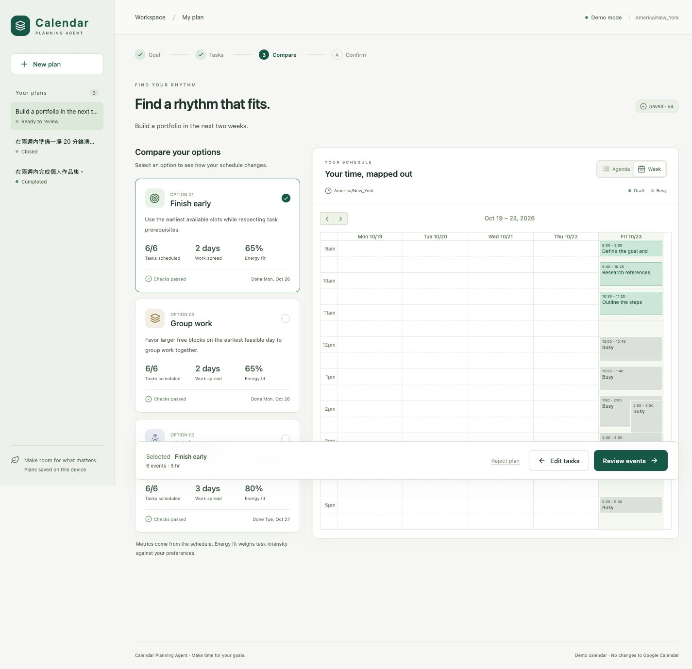

# Current Project Status

Updated 2026-10-23: restored the original English interface after the local workspace refactor. The main product is React + TypeScript → FastAPI → a shared Python planning service. The original research graph remains available, and Streamlit is a compatibility UI.

## Implemented

- Guided English UI: goal intake, editable task names/descriptions/durations/complexity/dependencies, three quantitative candidate cards, agenda/week view, explicit approval dialog, saved-plan history, and per-event results. Dates, calendar labels, system explanations, and new mock examples use English. User-authored goals and task text retain their original language. Mobile defaults to an agenda. FullCalendar React uses Luxon for IANA timezone support and is loaded separately from the main bundle.
- Pydantic request/storage models, stable task IDs, dependency DAG checks, and a shared application service used by both UIs. Editing increases the revision and invalidates candidates. Approval binds the exact revision and schedule hash.
- SQLite persistence for plans, revision snapshots, immutable approval identity, write ledger, and mock events. Per-plan POSIX file locks serialize mutations across local API/Streamlit processes. Saved stages survive refresh and process restart.
- One definition of local deadline boundaries, explicit timezone handling, UTC duration/interval arithmetic, DST tests, all-day calendar timezone handling, and filtering of transparent/cancelled/self-declined events.
- One pure scheduling engine behind all three strategy wrappers. It respects explicit dependencies, prevents scheduling a dependent whose prerequisite failed, checks session limits, and considers energy-period start boundaries.
- Deterministic coverage, dependency, duration, session, break, workday/hour, deadline, overlap, and interval validation. Unscheduled tasks remain visible. There is no automatic repair loop.
- Calendar revalidation before writing; new violations return to review for explicit acknowledgement. Stable provider event IDs, durable per-event results, and reconciliation handle repeated approval, partial writes, and lost insert responses. Confirmed writes are skipped on retry; all calendar writes remain add-only.
- Product decomposition uses one logical LLM call (before provider retries), then Pydantic/DAG validation. Metrics and explanations use rules. The optional research graph retains critic/review/rationale calls but ends at its proposal; its compatibility approval helper uses the shared writer instead of pretending to resume a durable graph.
- Python dependency declarations are unified in `pyproject.toml`; `requirements.txt` installs the project. Frontend dependencies have an npm lockfile. CI includes offline Python checks, a React build, and desktop/mobile mock browser scenarios.

## Verification

Verified locally on 2026-10-22, with the English-interface checks repeated on 2026-10-23:

| Check | Result |
|---|---|
| Full offline Python suite | **218 passed, 31 skipped** |
| New service/API, correctness, and Streamlit cases | **31 passed** (included above) |
| React TypeScript check + production build | Passed |
| Ruff fatal/undefined/unused checks on new core and refactored algorithms | Passed |
| Python compile check, `pip check`, `git diff --check` | Passed |
| Research graph mock smoke | Three validated proposals, stable plan ID, zero writes |
| Streamlit AppTest | Create → generate → approve/reject → reopen persisted results; no UI errors |
| Browser walkthrough | Create, edit name/estimate, regenerate, select strategy, view summary, approve six mock events, reload, return to edit, and reject another plan |
| Browser layout | Desktop week/agenda and 375px/320px mobile; no horizontal overflow observed; narrow action-button layout corrected |
| Browser console | No errors observed in the final walkthrough |
| Playwright test collection | Four scenarios collected (two flows × desktop/mobile) |
| English interface | Goal/task/review/confirmation copy, demo task content, date formatting, and desktop week labels verified; saved rule-copy compatibility covered by regression test |

The Playwright CLI browser scenarios were **not executed locally**; manual browser verification used the connected in-app browser. The four scenarios are configured for CI; the verification results above do not include a remote CI run. Do not count test collection as a passing E2E run.

```bash
CALENDAR_MODE=mock LLM_PROVIDER=mock .venv/bin/pytest tests/ -q --ignore=tests/llm_integration
npm --prefix web run build
```

The 31 skips are real-LLM pipeline fixtures. No live LLM/provider quality evaluation or live Google Calendar write was performed for this refactor. Historical live results in older reports do not validate the new application path.



## Remaining scope and limits

- **Local single user only.** No login, plan ownership isolation, multi-user token storage, or web OAuth callback. API Host/Origin guards do not replace authentication. Keep the server on localhost. SQLite locking currently requires macOS/Linux.
- **Saved state, not durable jobs.** Running provider calls do not resume after process death. Restart opens the last saved stage, and the user can retry. SSE, queues, job cancellation, and durable background execution remain future work.
- **External writes are not atomic.** Stable IDs and reconciliation reduce duplicate risk, but a calendar can change after preflight. Successes are retained on partial failure; there is no deletion-based rollback.
- **Greedy scheduling.** No optimality guarantee, split tasks, daily time budgets, multiple working windows, or manual drag/resize. A task exceeding the session limit needs manual editing. Same candidates are disclosed, but not merged into one card.
- **LLM evaluation.** Provider-native structured output, live schema compatibility, and quality/cost/latency benchmarks remain to be measured. Mock tasks are fixed examples, clearly labeled in the UI.
- **Engineering follow-up.** Generate TypeScript contracts from OpenAPI, lock Python transitive dependencies, add database migration/versioning before future schema changes, and expand browser/accessibility coverage. The current light theme has no dark variant.
- Older unused Streamlit components and research/deployment documents are retained for compatibility/history. The old iframe calendar is not used by either current entry point. Container/AWS scaffolding is not a verified deployment of this workspace.

## Next actions

1. Run the configured Playwright jobs in CI and inspect both viewport flows.
2. Evaluate real LLM task quality and compare the one-call product path with the research graph on a fixed dataset.
3. Validate Google OAuth/read/insert/reconciliation against a dedicated live test calendar.
4. Add production authentication, user isolation, migrations, and durable jobs only when a multi-user deployment is needed.

## References

- [README](../README.md) — current launch commands.
- [ARCHITECTURE.md](ARCHITECTURE.md) — contracts and write protocol.
- [DEVELOPER_GUIDE.md](DEVELOPER_GUIDE.md) — setup and tests.
- [REFACTOR_UX_REVIEW.md](REFACTOR_UX_REVIEW.md) — original audit and proposed future capabilities.
- `docs/archive/` and the project report — historical multi-agent implementation and evaluations.
